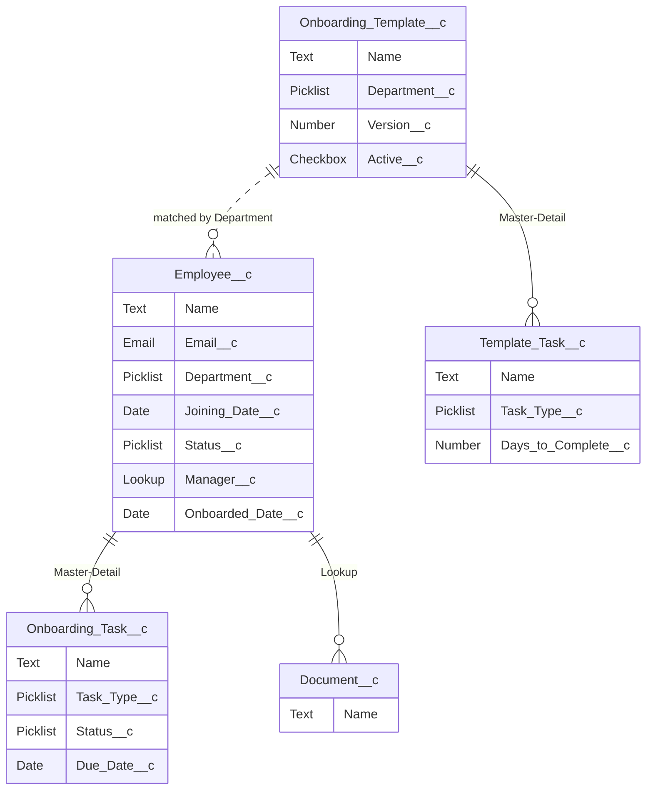

# Demo Guide — Employee Onboarding Portal

How to see each feature working in the org, and what to expect.

---

## Data model



| Relationship | Type | Reason |
|---|---|---|
| Onboarding Task → Employee | Master-Detail | A task has no meaning without its employee; it inherits sharing and is deleted with the employee. |
| Template Task → Onboarding Template | Master-Detail | A template task only exists as part of a template. |
| Document → Employee | Lookup | Documents may need to be retained for compliance even if the employee record is removed. |
| Onboarding Template ↔ Employee | Matched by Department | Templates are resolved at runtime, so HR can change templates without touching employee records. |

### Why a custom object for onboarding tasks instead of the standard Task?

| Need | Standard Task (Activity) | Custom `Onboarding_Task__c` |
|---|---|---|
| Master-Detail to Employee (cascade delete, inherited sharing, roll-up summaries) | Not possible: Task links to records through the polymorphic `WhatId`/`WhoId` fields | Yes |
| Custom lookup fields (e.g. to templates or documents) | Not supported on Activity | Yes |
| Long-term history for onboarding reports | Tasks are archived after ~365 days and drop out of standard queries and reports | Kept indefinitely |
| Reporting | Limited Activity report types | Own report type (used by *Open Overdue Tasks by Type*) |
| Separation from sales work | Mixed into users' *My Tasks*, calendar and activity timelines | Isolated onboarding checklist |

**Trade-off:** the custom object gives up Task's built-in reminders, *My Tasks* list and mobile notifications. These are replaced by `OnboardingEmailService` (new-task emails to the Manager) and `OnboardingReminderScheduler` (reminders 2 days before the due date).

---

## 1. Task generation on employee creation

**Steps:** Create an Employee (via the HR intake Screen Flow or **New**) with a Department that has an active template and a Joining Date.

**Expected:**
- Onboarding Tasks are created from the department's template
- Due Date = Joining Date + the template task's *Days to Complete*
- Employee Status changes from *Offer Accepted* → **In Progress**
- The LWC progress tracker shows tasks grouped by type with a progress bar

Implemented in `EmployeeTrigger` → `OnboardingTaskGenerator` (bulkified Apex trigger).

---

## 2. HR intake Screen Flow

Collects the new hire's details (Department as a picklist choice set) and creates the Employee record. Task generation is handled by the trigger, so tasks are generated identically whether the employee is created via the flow, the New button, or a data import.

---

## 3. Status roll-up

**Steps:** Mark all of an employee's tasks **Completed**.

**Expected:**
- Employee Status = **Onboarded**
- **Onboarded Date** set to today
- Progress tracker at 100%

Implemented in `OnboardingTaskTrigger` → `OnboardingTaskTriggerHandler` → `StatusRollupService`.

---

## 4. Department change

**Steps:**
1. Create an Employee with Department **Sales** → Sales tasks are created.
2. Change Department to **Engineering** → save.
3. Change Department back to **Sales** → save.

**Expected:**
- After step 2: Sales tasks **plus** Engineering tasks
- After step 3: no new tasks, no duplicates

**Design:**
- The trigger now runs on update, but only for employees whose Department actually changed.
- Existing tasks are kept rather than deleted, so completed work isn't lost.
- A duplicate guard skips any task the employee already has (matched on task name).

---

## 5. Template versioning

Onboarding Template now has **Version** and **Active** fields. The generator only uses active templates and selects the **highest version** per department, so a new checklist version can be rolled out without editing the old one or affecting existing employees.

**Steps:** Create a second Engineering template with Version = 2 and a different task list, then create a new Engineering employee → they receive the v2 tasks.

---

## 6. Role-based permission sets

| Permission set | For | Access |
|---|---|---|
| `Onboarding_Portal_Access` (HR) | HR / onboarding admins | Full CRUD on onboarding objects, including maintaining templates (incl. Active / Version fields) |
| `Onboarding_Manager_Access` | Managers | Read Employees, read/edit Onboarding Tasks, access to the progress tracker. No template access |

**Neither permission set grants View All Records.** Record visibility now comes from org-wide defaults and sharing instead of a blanket override; Onboarding Tasks and Template Tasks inherit visibility from their parent (Controlled by Parent).

---

## 7. Reports, dashboard and notifications

- **HR Onboarding Dashboard**
  - *Open Overdue Tasks by Type*
  - *Average Time-to-Onboard by Department* (`Onboarded_Date__c − Joining_Date__c`)
- **Email** to the employee's Manager when tasks are created (`OnboardingEmailService`)
- **Scheduled reminder** for tasks due in 2 days (`OnboardingReminderScheduler`)

---

## 8. Code quality and tests

- ApexDoc on every Apex class, trigger and test method
- No SOQL or DML inside loops
- New test: `testDepartmentChange_addsNewTasksWithoutDuplicates`
- Bulk test: `testBulkInsert` (50 employees in one transaction)

Run tests:

```
sf apex run test --code-coverage --result-format human --wait 10
```

| Class | Coverage |
|---|---|
| OnboardingTaskGenerator | 96% |
| EmployeeTrigger | 100% |
| OnboardingProgressController | 100% |
| OnboardingReminderScheduler | 100% |
| OnboardingTaskTrigger | 100% |
| OnboardingTaskTriggerHandler | 96% |
| StatusRollupService | 93% |
| OnboardingEmailService | 91% |

---

## Included metadata

The HR intake Flow, both reports and the dashboard are included in the repo under `force-app/main/default/flows`, `reports` and `dashboards`.
